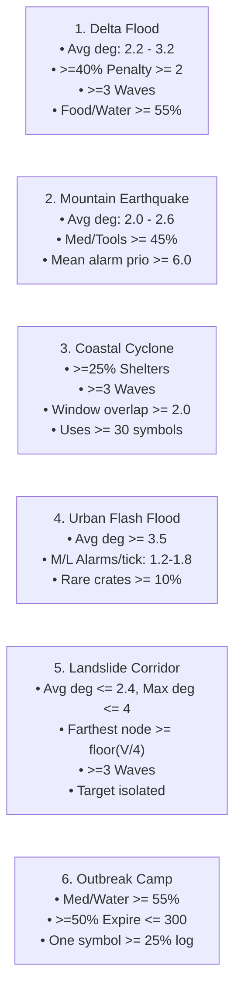

# LIFELINE: Algorithmic Relief-Command Engine (Phase 1)

**Course:** Design and Analysis of Algorithms (CS/AI)  
**Institution:** National University of Computer and Emerging Sciences (FAST-NUCES), Islamabad Campus  
**Group Number:** 66 | **Section:** A  
**Team Members:**  
* **Member 1:** Roll No `24i-0104` (Section A)  
* **Member 2:** Roll No `24i-0020` (Section A)  
**GitHub Repository:** [https://github.com/Techstop-creator/24I-0104-A_24I-0020-A](https://github.com/Techstop-creator/24I-0104-A_24I-0020-A)  

---

## 1. Quick-Start Guide

### A. Reproduce Dataset from Group Seed ($s = 66$)
To generate the master 50-case workbook (`cases.xlsx`) from scratch using the deterministic seed:
```bash
python generator/main.py --seed 66 --output cases.xlsx
```
*(Or navigate into `generator/` and run `python main.py --seed 66 --output ../cases.xlsx`).*

### B. Run the Zero-Trust Validator
To validate `cases.xlsx` against all structural, topological, combinatorial, signature, variety, and trap rules (V1 through V8):
```bash
python validator/validator.py cases.xlsx
```
**Expected Output:**
```text
PASS! All 50 cases strictly comply with V1 through V8.
```

### C. Run Full Test Suite & Negative Rejection Audit
To validate `cases.xlsx` and verify that the validator correctly rejects all 10 corrupted test cases in `validator/tests/`:
```bash
python validator/run_suite.py validation_report.txt
```
**Expected Output:**
```text
SUMMARY: Master dataset PASS. Rejection audit: 10/10 broken copies correctly rejected.
Consolidated report written to validation_report.txt
```

### D. Compile Documentation PDFs (ReportLab)
To regenerate the 2-page `approach_note.pdf` and strictly 2-page `proposal.pdf`:
```bash
python generate_documents.py
```

### E. Build Final Submission Archive
To create the official submission ZIP archive matching class naming conventions:
```bash
python create_submission_zip.py
```

---

## 2. Directory Structure

```text
24I-0104-A_24I-0020-A/
├── README.md                                         # Master documentation & replication guide
├── approach.md                                       # Markdown version of 4-part approach note
├── approach_note.pdf                                 # Formatted 2-page approach note (PDF)
├── approach_note.docx                                # Editable Word version of approach note
├── proposal.pdf                                      # Strictly 2-page algorithm proposal (PDF)
├── members.txt                                       # Team credentials, section & group seed
├── repository.txt                                    # Private GitHub repository URL
├── cases.xlsx                                        # Master dataset (50 cases across 20 sheets)
├── validation_report.txt                             # Validator PASS output & negative rejection logs
├── create_submission_zip.py                         # Automated packager for official ZIP
├── generate_documents.py                             # ReportLab generator for 2-page PDFs
├── generate_docx.py                                  # Python-docx generator for Word documents
├── setup_github_and_collaborators.py                 # GitHub REST API automation utility
├── generator/
│   ├── main.py                                       # Excel serializer & natural sorting engine
│   ├── case_generator.py                             # Algorithmic case synthesizer for Tiers S, M, L, X
│   ├── algorithms.py                                 # Exact combinatorial DP & heuristic solvers
│   └── README.md                                     # One-command generator replication guide
└── validator/
    ├── validator.py                                  # Independent zero-trust validator (Checks V1–V8)
    ├── create_broken_tests.py                        # Negative test case generator
    ├── run_suite.py                                  # Automated test suite runner
    ├── README.md                                     # Validator documentation
    └── tests/                                        # 10 corrupted test cases for rejection audit
        ├── case_00_broken_1_V1_bad_sheet.xlsx
        ├── case_00_broken_2_V2_crate_weight.xlsx
        ├── case_00_broken_3_V3_dangling_target.xlsx
        ├── case_00_broken_4_V4_disconnected_graph.xlsx
        ├── case_00_broken_5_V5_wrong_claim.xlsx
        ├── case_20_broken_1_V2_bad_penalty.xlsx
        ├── case_20_broken_2_V4_overlapping_waves.xlsx
        ├── case_20_broken_3_V5_bad_pattern_count.xlsx
        ├── case_20_broken_4_V6_unsat_3sat.xlsx
        └── case_20_broken_5_V6_invalid_rations.xlsx
```

---

## 3. Dataset Architecture (`cases.xlsx`)

The workbook contains **exactly 20 sheets in exact order**, with zero formulas, pure integer values, plain ASCII text, and rows sorted by `case_id` ascending, then by the second column ascending:

| # | Sheet Name | Second Column (Sort Key) | Description & Rules |
| :-: | :--- | :--- | :--- |
| **1** | `cases` | `group_seed` | 50 rows ($k=00 \dots 49$). Metadata, targets (distinct S/H, not HQ), bounds. |
| **2** | `crates` | `crate_id` | Weight ($1\dots 20$), value ($10\dots 100$), expiry ($0\dots 999$), distinct 8-digit serials. |
| **3** | `locations` | `loc_id` | Node 0 is HQ (D, penalty 0). Penalties $\in \{0, 1, 2, 4, 6\}$. $\ge 1$ Shelter and Hospital. |
| **4** | `roads` | `road_no` | Connected undirected graph ($E \in [V-1, 3V]$). Cost of $u \to v$ is $\text{minutes} + \text{penalty}(v)$. |
| **5** | `waves` | `wave_no` | 2 to 5 disjoint closure waves; each wave has $1 \dots \max(1, \lfloor E/4 \rfloor)$ closed roads. |
| **6** | `radio_log` | `part` | 38-symbol alphabet (`A-Z`, `0-9`, `_`, `-`). Text chunked $\le 10,000$ symbols per row. |
| **7** | `radio_patterns` | `pattern_no` | Exactly 6 patterns of lengths 2, 4, 8, 12, 20, 40 with exact overlapping counts. |
| **8** | `radio_reports` | `report_a` | Two text reports. `edit_bound` is within $[\text{Levenshtein}(a, b), \text{len}(a) + \text{len}(b)]$. |
| **9** | `windows` | `window_id` | Rescue time intervals ($0 \le \text{start} < \text{finish} \le 1440$). At least 2 pairs touch. |
| **10**| `incidents` | `alarm_id` | Ticks non-decreasing. Priorities $1 \dots 10$. On M/L, rate $\in [1.2, 1.8]$ alarms/tick. |
| **11**| `sites` | `site_no` | Coordinates $x, y \in [0, 999]$. No two sites equal. |
| **12**| `tour` | `step` | Permutation of all sites starting at Site 0 with closed Manhattan distance. |
| **13**| `pipeline_dims` | `idx` | Matrix chain dimensions $d_0 \dots d_n$ ($n+1$ integers in $[2, 100]$). |
| **14**| `drum_prices` | `length` | Prices for cutting length $1 \dots L$ (positive integers $\le 500$, not all proportional). |
| **15**| `sensor_edges` | `u` | Sensor network graph ($u < v$, no loops, no multi-edges, $\ge n-1$ edges). |
| **16**| `sensor_cover` | `node` | Planted vertex cover of size $k \in [2, n/2]$ touching every edge in `sensor_edges`. |
| **17**| `safety_rules` | `rule_no` | 3-SAT clauses with 3 distinct non-zero literals. Ratio $M/N \in [2.0, 6.0]$. |
| **18**| `safety_planted` | `switch` | Planted truth assignment vector $A \in \{0, 1\}^N$ satisfying every 3-SAT rule. |
| **19**| `rations` | `item` | Subset sum items. Values with `planted == 1` sum exactly to `rations_target`. |
| **20**| `claims` | `cargo_opt` | **Tier S only (20 rows).** Exact global optima for 6 benchmark algorithms. |

---

## 4. Disaster Scenarios & Mathematical Signatures

For cases $k = 0 \dots 45$, the scenario is strictly assigned as `(k mod 6) + 1`:



---

## 5. Hostile Traps (Cases 46 to 49, Tier X)

* **Case 46 (Dock-Order Trap | Story 5):** 1,600 crates pre-sorted monotonically in non-decreasing order across 5 fields (`weight`, `value`, `expiry`, `serial`, `value_per_kg`). Triggers $O(N^2)$ worst case in deterministic, non-randomized Quicksort implementations.
* **Case 47 (Best-Looking-Crate Trap | Story 6):** Capacity $W = 20$. Crate 1 ($w=11, v=55$, ratio $5.0$) traps greedy density into selecting it, yielding value $55$. Optimal 0/1 knapsack selects Crates 2 & 3 ($w=10+10=20$, value $48+48=96$). Greedy achieves $55/96 = \mathbf{57.29\% \le 60\%}$.
* **Case 48 (Shortest-Looks-Cheapest Trap | Story 1):** Network with 1,600 locations and a 600-node linear chain ($> 500$ roads). Direct path to target 0 has 1 road (cost 66). Alternate path has 3 roads (cost 9). Unweighted BFS chooses the 1-road path, which is $\mathbf{7.33\times}$ more expensive than Dijkstra's cheapest route ($\ge 1.5\times$).
* **Case 49 (Near-Miss Trap | Story 2):** 60,000-character log of repeated `'A'`s. Patterns have length-1 prefixes of all `'A'`s matching at $100\%$ of start positions, causing naive matchers to thrash in $O(N \cdot M)$ time before failing on the final symbol.

---

## 6. Cross-Case Variety Rules

1. **Greedy Knapsack Failure:** In 6 Tier-S cases (Cases 0, 1, 2, 3, 4, 5), greedy value-per-kg is strictly suboptimal ($\ge 5$ required).
2. **Fewest-Hop vs Cheapest-Cost Discrepancy:** In 6 Tier-S cases, every fewest-roads route costs strictly more than Dijkstra's cheapest path ($\ge 5$ required).
3. **3-SAT Clause Density Distribution (26 M & L cases):**
   * 6 cases have $M/N < 3.5$ ($\ge 5$ required).
   * 10 cases have $3.5 \le M/N \le 4.8$ ($\ge 8$ required).
   * 10 cases have $M/N > 4.8$ ($\ge 5$ required).
4. **Case Uniqueness:** No two cases are identical in any module of size $\ge 8$.

---

## 7. Zero-Trust Validator & Negative Rejection Suite

The validator independently parses raw files, reconstructs data structures, and checks rules V1 through V8:
* **V1:** Schema, headers, 50 case IDs (`66-00` to `66-49`), tiers, scenarios.
* **V2:** Sizes, numerical ranges, capacity ratios ($10\%\dots 70\%$).
* **V3:** Consecutive IDs, valid road endpoints ($u < v$), target node validity.
* **V4:** Graph connectivity before closures (BFS), wave disjointness and size limits.
* **V5:** Pattern counts with overlaps, Levenshtein edit distance bounds, Tier-S exact claims.
* **V6:** Planted TSP tour closed Manhattan length, planted sensor cover, 3-SAT assignment, subset sum target.
* **V7:** Signatures for Scenarios 1–6 and cross-case variety rules 1–4.
* **V8:** Adversarial conditions for Traps 46, 47, 48, and 49.

### Rejection Testing (`validator/tests/`)
10 intentionally broken workbooks verify negative rejection paths:
1. `case_00_broken_1_V1_bad_sheet.xlsx`: Renamed `claims` sheet $\implies$ REJECTED (`V1`).
2. `case_00_broken_2_V2_crate_weight.xlsx`: Crate weight $= 99$ kg $\implies$ REJECTED (`V2`).
3. `case_00_broken_3_V3_dangling_target.xlsx`: Target $= 999$ $\implies$ REJECTED (`V3`).
4. `case_00_broken_4_V4_disconnected_graph.xlsx`: Disconnected components $\implies$ REJECTED (`V4`).
5. `case_00_broken_5_V5_wrong_claim.xlsx`: Corrupted `cargo_opt` $\implies$ REJECTED (`V5`).
6. `case_20_broken_1_V2_bad_penalty.xlsx`: HQ penalty $= 99$ $\implies$ REJECTED (`V2`).
7. `case_20_broken_2_V4_overlapping_waves.xlsx`: Duplicate closed road $\implies$ REJECTED (`V4`).
8. `case_20_broken_3_V5_bad_pattern_count.xlsx`: Altered pattern count $\implies$ REJECTED (`V5`).
9. `case_20_broken_4_V6_unsat_3sat.xlsx`: Unsatisfiable 3-SAT clause $\implies$ REJECTED (`V6`).
10. `case_20_broken_5_V6_invalid_rations.xlsx`: Corrupted target sum $\implies$ REJECTED (`V6`).

---

## 8. Work Division & Git History

### Iteration 1 Responsibilities
* **Member 1 (`24i-0104`):** Core generator architecture (`main.py`, openpyxl serializer), Crates, Locations, Roads, Wave Closures, Traps 46 & 48, Validator checks V1, V2, V3, V4, V7, and Approach Note Parts 1 & 3.
* **Member 2 (`24i-0020`):** Radio Log & Chunking, Patterns, Reports & Levenshtein mutation, Windows, Incidents, Sites, TSP Tour, Pipeline Dimensions, Drum Prices, Sensor Cover, 3-SAT, Rations, Exact Tier-S Solvers, Traps 47 & 49, Validator checks V5, V6, V8, Broken Test Suite, and Proposal Document.

### Commit History (Alternating Multi-Author)
```text
7335345 - 24i-0020: docs: add editable Word (.docx) version of approach note and setup tools
81a9e8b - 24i-0104: chore: update repository.txt with official GitHub repository URL
e9a77b1 - 24i-0104: build: add automated submission packager and finalize Phase 1 delivery
6c00b90 - 24i-0020: docs: author two-page approach note and algorithm selection proposal
709c150 - 24i-0104: data: generate verified master cases.xlsx dataset and validation report
4e91599 - 24i-0020: test(validator): create 10 broken test cases for negative rejection audit
6c31dec - 24i-0104: feat(validator): implement independent zero-trust validator engine with V1-V8 checks
a66ede5 - 24i-0104: feat(generator): implement 50-case generator, scenario signatures and hostile traps
340a412 - 24i-0020: feat(generator): implement exact combinatorial solvers and DP algorithms for Tier S claims
b4e8106 - 24i-0104: chore: initialize LIFELINE Phase 1 project structure and metadata
```

---

## 9. Submission Deliverable

Upload **`24I-0104-A_24I-0020-A.zip`** to Google Classroom (GCR).  
Verify that course instructors (`Rida-Zubair`, `aymanirshad`, `mariamshaiq`) are invited as collaborators on your private GitHub repository:  
[https://github.com/Techstop-creator/24I-0104-A_24I-0020-A/settings/access](https://github.com/Techstop-creator/24I-0104-A_24I-0020-A/settings/access).
